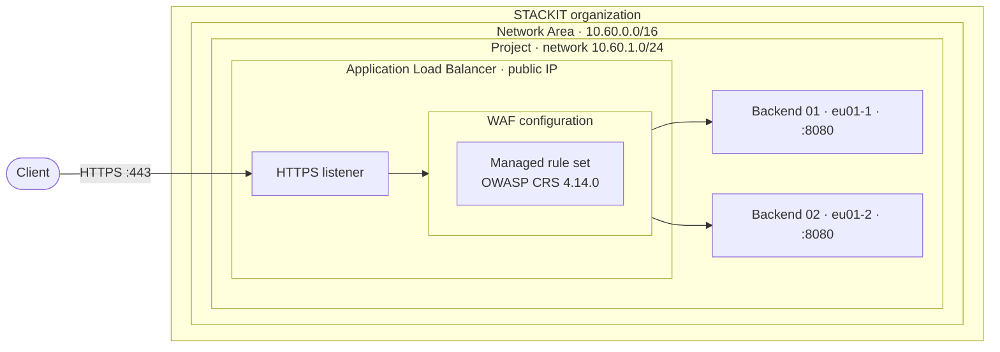

<!-- tags: iaas, alb, waf, load-balancer, layer7, networking, sna, tls, owasp-crs, ha, cross-az -->

# ALB WAF Rule Tuning

A STACKIT Application Load Balancer with a public IP and a Web Application Firewall in front of two VMs, inside a STACKIT Network Area. The example disables individual rules of the managed rule set, switches them to log-only and enables them again from Terraform.

## Overview

The Web Application Firewall (WAF) of the Application Load Balancer (ALB) applies a managed rule set: a copy of the OWASP Core Rule Set (CRS) that STACKIT maintains, with 321 rules in 20 groups. A listener of the load balancer refers to a WAF configuration by name, and the WAF configuration refers to the managed rule set.

| Object            | Terraform resource                 | What it holds                                            |
| ----------------- | ---------------------------------- | -------------------------------------------------------- |
| Managed rule set  | `stackit_alb_waf_managed_rule_set` | The rules of the OWASP Core Rule Set and their modes     |
| WAF configuration | `stackit_alb_waf_configuration`    | The reference to the managed rule set a listener applies |

What can be changed in a managed rule set:

| Task                                         | Possible | How                                                                      |
| -------------------------------------------- | -------- | ------------------------------------------------------------------------ |
| Switch a single rule                         | Yes      | Each rule has a mode: `MODE_ENABLED`, `MODE_LOG_ONLY` or `MODE_DISABLED` |
| Switch a whole group                         | Per rule | A group has no mode of its own; list every rule of the group             |
| Switch a rule for one path or parameter only | No       | The mode has no condition                                                |
| Edit a rule                                  | No       | The mode is the only field of a rule that the API accepts                |
| Add a rule                                   | No       | The API has no operation for it                                          |
| Create a managed rule set with rules you own | No       | `TYPE_OWASP_CRS` is the only type of managed rule set                    |
| Set a paranoia level or an anomaly threshold | No       | The API has no field for either                                          |

The mode belongs to the managed rule set. WAF configurations that refer to the same managed rule set share its modes.

A WAF configuration can also refer to a custom rule group with rules of your own. This example does not use one; [`iaas-cross-az-layer7-loadbalancer-waf`](../iaas-cross-az-layer7-loadbalancer-waf/README.md) does.

The STACKIT documentation describes the objects in [Basic concepts of the ALB WAF](https://docs.stackit.cloud/products/network/load-balancing-and-content-delivery/application-load-balancer/basics/basic-concepts-alb-waf/) and [ALB WAF features](https://docs.stackit.cloud/products/network/load-balancing-and-content-delivery/application-load-balancer/basics/features-alb-waf/).

Requires provider `stackitcloud/stackit` 0.117.0 or later.

## Architecture



## What gets created

| Component     | Resource                                                                                    | Purpose                                                                                       |
| ------------- | ------------------------------------------------------------------------------------------- | --------------------------------------------------------------------------------------------- |
| Network area  | `stackit_network_area`, `stackit_network_area_region`                                       | STACKIT Network Area (SNA) on organization level with the address range `10.60.0.0/16`        |
| Project       | `stackit_resourcemanager_project`                                                           | New project that joins the network area through the `networkArea` label                       |
| Network       | `stackit_network`, `stackit_security_group`, `stackit_security_group_rule`                  | Network `10.60.1.0/24` and a security group that opens port 8080 inside the network           |
| Backends      | `stackit_server`, `stackit_network_interface` (one per availability zone)                   | Debian VMs, provisioned by cloud-init with a test application (`files/server.py`)             |
| Certificate   | `tls_private_key`, `tls_self_signed_cert`, `stackit_alb_certificate`                        | Self-signed certificate of the HTTPS listener                                                 |
| WAF           | `stackit_alb_waf_managed_rule_set`, `stackit_alb_waf_configuration`                         | Managed rule set and the WAF configuration that refers to it                                  |
| Rule modes    | `terraform_data`, `ephemeral.stackit_access_token`, `data.stackit_alb_waf_managed_rule_set` | Sets the modes of the managed rule set through the API and reads them back                    |
| Load balancer | `stackit_application_load_balancer`                                                         | HTTPS listener on a public IP with the WAF configuration, one target pool with a health check |

A project joins a network area at creation only, which is why the example creates the project. The load balancer allocates its public IP itself (`options.ephemeral_address = true`) and releases it on destroy.

The test application answers every request with `200` and a JSON body that names the backend, so a `200` proves that the WAF let the request pass and a `403` that it blocked it.

## Managed rule set

### How the modes are set

`stackit_alb_waf_managed_rule_set` exposes the groups and rules as read-only attributes and has no update. The API has an operation for it: `PATCH /v1/projects/{projectId}/regions/{region}/managed-rule-sets/{name}` takes a mode per rule. [`080-waf.tf`](080-waf.tf) sends that request from a `terraform_data` resource with a `local-exec` provisioner:

1. The request body is built from the `groups` attribute of the managed rule set. It lists **every** rule with the mode from `managed_rule_modes`, or `MODE_ENABLED` for a rule that the variable does not list.
2. `ephemeral.stackit_access_token` issues a token for the service account of the provider. An ephemeral resource is written neither to the plan nor to the state.
3. `curl` sends the request. `terraform_data` is replaced, and the request sent again, whenever the request body changes or the managed rule set is replaced.
4. `data.stackit_alb_waf_managed_rule_set.effective` reads the rule set after the request. The outputs `managed_rule_mode_counts` and `managed_rule_overrides` come from this data source.

Because the request lists every rule, a rule that is removed from `managed_rule_modes` returns to `MODE_ENABLED` on the next apply. A new managed rule set starts with all rules in `MODE_ENABLED`.

| Mode            | Behavior                                                           |
| --------------- | ------------------------------------------------------------------ |
| `MODE_ENABLED`  | The rule inspects the request and applies its action on a match    |
| `MODE_LOG_ONLY` | The rule inspects the request and logs a match; the request passes |
| `MODE_DISABLED` | The rule is skipped; nothing is inspected or logged                |

The load balancer ships the WAF records to STACKIT Observability when `options.observability.logs` is set. This example does not set it. [`alb-observability-and-alerting`](../alb-observability-and-alerting/README.md) ships them and reads them from the log stream `{component="waf"}`.

### Find the rule IDs

The rule IDs are those of the OWASP Core Rule Set. `terraform console` lists them with mode, severity and description, here for the groups 911 and 913. The command reads the deployed rule set, so it needs a completed `terraform apply`.

```bash
echo '{ for id, rule in local.managed_rules_effective : id => "${rule.mode} ${rule.severity} ${rule.description}" if startswith(rule.group, "911") || startswith(rule.group, "913") }' | terraform console
```

```
{
  "911100" = "MODE_ENABLED CRITICAL Method is not allowed by policy"
  "913100" = "MODE_DISABLED CRITICAL Found User-Agent associated with security scanner"
}
```

Without the `if` clause the expression lists all rules. The groups of version 4.14.0:

| Group | Name                  | Rules | Group | Name               | Rules |
| ----- | --------------------- | ----- | ----- | ------------------ | ----- |
| 911   | Method Enforcement    | 1     | 941   | XSS Protection     | 33    |
| 913   | Scanner Detection     | 1     | 942   | SQL Injection      | 60    |
| 920   | Protocol Enforcement  | 56    | 943   | Session Fixation   | 3     |
| 921   | HTTP Smuggling        | 17    | 944   | JAVA Injection     | 14    |
| 922   | Multipart Enforcement | 4     | 950   | Outbound Leakage   | 3     |
| 930   | LFI Protection        | 5     | 951   | SQL Leakage        | 16    |
| 931   | RFI Protection        | 5     | 952   | Java Leakage       | 1     |
| 932   | RCE Protection        | 40    | 953   | PHP Leakage        | 4     |
| 933   | PHP Injection         | 18    | 954   | IIS Leakage        | 4     |
| 934   | Node.js Injection     | 9     | 955   | Web Shell Response | 27    |

### Change a mode

The default of `managed_rule_modes` in [`020-variables.tf`](020-variables.tf) disables one rule and switches one rule to log-only:

```hcl
managed_rule_modes = {
  "913100" = "MODE_DISABLED" # Found User-Agent associated with security scanner
  "942100" = "MODE_LOG_ONLY" # SQL Injection Attack Detected via libinjection
}
```

To use other modes, set the variable in `terraform.tfvars` and apply. The value replaces the default as a whole: list every rule that is not to be in `MODE_ENABLED`, or set `managed_rule_modes = {}` to enable all rules.

| Goal                           | Entry in `managed_rule_modes`                   |
| ------------------------------ | ----------------------------------------------- |
| Disable a rule                 | `"<rule ID>" = "MODE_DISABLED"`                 |
| Log matches, let requests pass | `"<rule ID>" = "MODE_LOG_ONLY"`                 |
| Enable a rule again            | Remove the entry, or set it to `"MODE_ENABLED"` |

The plan replaces `terraform_data.managed_rule_modes` and nothing else. The load balancer applies the new modes a few seconds after the apply. A rule ID that the rule set does not contain fails the plan:

```
Error: Resource precondition failed

managed_rule_modes lists rule IDs that the managed rule set does not contain:
999999.
```

### Changes made outside of Terraform

The modes can also be changed with `stackit beta alb-waf managed-rule-set update` or through the API. Terraform does not revert such a change on its own, because the request body it compares has not changed. The check block `managed_rule_modes` compares the mode the API returns for every rule with the mode from the variable `managed_rule_modes`, or `MODE_ENABLED` for a rule that the variable does not list, and reports a deviation as a warning on `plan` and `apply`:

```
Warning: Check block assertion failed

These rules of the managed rule set are not in the mode this configuration
asks for: 941100. Run `terraform apply
-replace=terraform_data.managed_rule_modes` to set them again.
```

The outputs `managed_rule_mode_counts` and `managed_rule_overrides` show the deviation as a change in the same plan.

## Prerequisites

| Tool                | Version   |
| ------------------- | --------- |
| Terraform           | >= 1.10.0 |
| curl, a POSIX shell | any       |

Terraform runs `curl` on the machine that executes `terraform apply`. The `local-exec` provisioner uses `sh`, so the example runs on Linux and macOS.

A STACKIT service account key is required whose service account may create network areas in `stackit_org_id`, create projects under `stackit_parent_container_id` and manage resources in the created project. The provider must authenticate with the key; `ephemeral.stackit_access_token` does not work with other authentication methods. `stackit_admin_email` must be an existing STACKIT user; a non-existent address fails with `409 Conflict ... subject is not found`.

The project needs quota for one load balancer, one public IP, two VMs and three security groups (one of the example, two that the load balancer creates for itself and its targets). A project holds up to 150 managed rule sets and 150 WAF configurations.

## Usage

### 1. Configure variables

```bash
cp terraform.tfvars.example terraform.tfvars
# fill in stackit_org_id, stackit_parent_container_id, stackit_admin_email
# and stackit_service_account_key_path
```

All other variables have defaults, see [`020-variables.tf`](020-variables.tf). `network_cidr` must lie inside `sna_network_range`.

### 2. Deploy

```bash
terraform init
terraform apply
```

The apply takes about five minutes. Terraform prints warnings that `stackit_access_token` is a beta resource and, for the provisioner, `(output suppressed due to ephemeral value in config)`. A plan that changes a rule mode also prints `Check block assertion known after apply`, because the check reads the rule set after the request. The outputs show the modes the API returned after the request:

```
managed_rule_mode_counts = {
  "MODE_DISABLED" = 1
  "MODE_ENABLED" = 319
  "MODE_LOG_ONLY" = 1
}
managed_rule_overrides = {
  "913100" = {
    "description" = "Found User-Agent associated with security scanner"
    "group" = "913 Scanner Detection (SCANNER DETECTION)"
    "mode" = "MODE_DISABLED"
    "severity" = "CRITICAL"
  }
  "942100" = {
    "description" = "SQL Injection Attack Detected via libinjection"
    "group" = "942 SQL Injection (APPLICATION ATTACK SQLI)"
    "mode" = "MODE_LOG_ONLY"
    "severity" = "CRITICAL"
  }
}
managed_rule_set_version = "4.14.0"
```

### 3. Verify

The certificate is self-signed, so `curl` runs with `-k`. `st` prints the status code of a request. If a request times out right after the apply, wait a minute and repeat it.

```bash
export ALB_IP=$(terraform output -raw alb_external_address)
st() { curl -sk -o /dev/null -w '%{http_code}\n' "$@"; }

curl -sk "https://$ALB_IP/"
```

```
{"backend": "alb-waf-backend-01", "method": "GET", "path": "/", "body_bytes": 0}
```

| Command                                             | Status | Why                                    |
| --------------------------------------------------- | ------ | -------------------------------------- |
| `st "https://$ALB_IP/"`                             | `200`  | No rule matches                        |
| `st "https://$ALB_IP/?q=<script>alert(1)</script>"` | `403`  | Managed rule set, cross-site scripting |
| `st "https://$ALB_IP/?file=../../etc/passwd"`       | `403`  | Managed rule set, path traversal       |
| `st -A nikto "https://$ALB_IP/"`                    | `200`  | Rule 913100 is in `MODE_DISABLED`      |
| `st "https://$ALB_IP/?id=1'%20OR%20'1'='1"`         | `200`  | Rule 942100 is in `MODE_LOG_ONLY`      |

### 4. Enable the two rules again

```bash
terraform apply -var 'managed_rule_modes={}'
```

Both rules return to `MODE_ENABLED`, `managed_rule_overrides` is empty, and the two requests are blocked:

| Command                                     | Status |
| ------------------------------------------- | ------ |
| `st -A nikto "https://$ALB_IP/"`            | `403`  |
| `st "https://$ALB_IP/?id=1'%20OR%20'1'='1"` | `403`  |

## Clean up

```bash
terraform destroy
```

The destroy removes the project and the network area as well.
