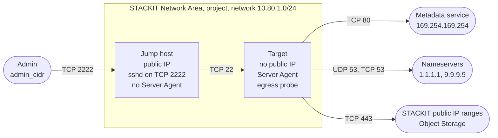

<!-- tags: iaas, compute, networking, sna, security-group, egress, cloud-init, server-agent, jump-host, ssh -->

# Restricted Egress for a VM with cloud-init and the STACKIT Server Agent

Deploys a Linux VM whose security group allows outbound traffic to an allow-list only, with the STACKIT Server Agent switched on, and a jump host as the only way to reach it over SSH. The example lists the outbound rules the STACKIT documentation names for cloud-init and the Server Agent, removes the default egress rules that Terraform cannot manage, and adds a probe that logs the destination of every new outbound connection once cloud-init has loaded it, so you can check and extend the list.

## What the example shows

A security group rule only allows. Every new security group starts with two rules that allow all outbound traffic, so an egress rule of your own restricts nothing until those two are gone. This example removes them before the VM boots for the first time. The first boot is the one that matters: cloud-init runs then, and the platform installs the Server Agent then.

**cloud-init and the Server Agent are two different things.** [cloud-init](https://docs.cloud-init.io/en/latest/explanation/boot.html) is part of the image. It runs at boot and reads metadata, user data and vendor data from the [metadata service](https://docs.stackit.cloud/products/compute-engine/server/basics/maintenance/) at `http://169.254.169.254`. The [STACKIT Server Agent](https://docs.stackit.cloud/products/compute-engine/server-agent/basics/introduction-to-server-agent/) is a service of its own. The platform [installs it during the first boot through vendor data](https://docs.stackit.cloud/products/compute-engine/server-agent/getting-started/installing-server-agent-api/), and [Run Command](https://docs.stackit.cloud/products/compute-engine/run-command/) and Server Update Management use it afterwards.

The example creates:

- a STACKIT Network Area (SNA) with its regional configuration, a project attached to it and one network
- a **jump host** with a public IP, whose security group admits TCP 2222 from `admin_cidr` and whose sshd listens on that port
- a **target** without a public IP, with the Server Agent, an egress allow-list and a probe that logs every new outbound connection once cloud-init has loaded it
- a step that deletes the two default egress rules of the target's security group through the IaaS API

## Architecture



Each machine has its own security group, and its network interface carries that group and no other. Terraform adds one ingress rule to each group:

| Security group | Ingress rule | Source                                    |
| -------------- | ------------ | ----------------------------------------- |
| jump host      | TCP 2222     | `admin_cidr`                              |
| target         | TCP 22       | members of the jump host's security group |

Nothing else reaches the jump host from outside, and nothing but the jump host reaches the target. Both groups are stateful: the answers to an allowed connection pass without a rule of their own. The target therefore needs no egress rule for the SSH sessions that arrive from the jump host.

sshd on the jump host listens on port 2222 itself. No port forwarding sits in front of it, and port 22 is closed. It accepts public keys only. TCP forwarding stays on, because `ssh -J` opens the connection to the target through it. The private key never leaves your machine.

The jump host is not the subject of the egress test. Its security group keeps the two default egress rules.

## Egress rules of the target

`egress_rules` holds every egress rule this example adds to the target's security group. Its default holds the destinations the STACKIT documentation names:

| Key                  | Destination                                    | Protocol and port | What needs it                                                                                                                                         | Source                                                                                                                                                                                                                                                                                                                                                                                                                                                         |
| -------------------- | ---------------------------------------------- | ----------------- | ----------------------------------------------------------------------------------------------------------------------------------------------------- | -------------------------------------------------------------------------------------------------------------------------------------------------------------------------------------------------------------------------------------------------------------------------------------------------------------------------------------------------------------------------------------------------------------------------------------------------------------- |
| `metadata`           | `169.254.169.254/32`                           | TCP 80            | cloud-init reads metadata, user data and vendor data. The Server Agent package comes from `http://169.254.169.254/stackit/v1/server-agent/amd64/deb`. | [cloud-init boot stages](https://docs.cloud-init.io/en/latest/explanation/boot.html) for the stages, [Windows Server FAQ](https://docs.stackit.cloud/products/compute-engine/windows-server/faq/) for the address as an outbound rule of a custom security group, [Install the Server Agent on a running server](https://docs.stackit.cloud/products/compute-engine/server-agent/getting-started/installing-server-agent-existing-server/) for the package URL |
| `dns-udp`, `dns-tcp` | every address in `nameservers`                 | UDP 53, TCP 53    | Name resolution for the HTTPS endpoint below.                                                                                                         | [Windows Server FAQ](https://docs.stackit.cloud/products/compute-engine/windows-server/faq/), which lists the metadata service and DNS as outbound rules of a custom security group                                                                                                                                                                                                                                                                            |
| `https-stackit`      | every IPv4 range of `stackit_public_ip_ranges` | TCP 443           | Signature check of the Server Agent package. Key and signature come from `https://stackit-server-agent.object.storage.<region>.onstackit.cloud`.      | [Install the Server Agent on a running server](https://docs.stackit.cloud/products/compute-engine/server-agent/getting-started/installing-server-agent-existing-server/)                                                                                                                                                                                                                                                                                       |

`ip_range` of a rule takes a CIDR or one of two names. `nameservers` stands for every address in the variable `nameservers`, which also configures the network. `stackit` stands for every IPv4 range the data source `stackit_public_ip_ranges` returns. A security group rule takes one range, so Terraform creates one rule per range.

The Object Storage endpoint of the signature check lies inside the STACKIT public IP ranges. The API hosts `iaas.api.stackit.cloud` and `run-command.api.stackit.cloud` resolve to an address outside them, so the rule `https-stackit` does not cover them. [`scripts/check-stackit-ip.sh`](../../scripts/check-stackit-ip.sh) tells for any address whether it belongs to the ranges.

The list has no rule for NTP (UDP 123) and none for the package mirrors of the image. It has no IPv6 rule; the network has no IPv6 prefix. Add what your machine needs through `egress_rules`. The section [Measure what a VM needs](#measure-what-a-vm-needs) shows how to find it.

## How the default egress rules are removed

[Every new security group contains a rule that allows all egress traffic](https://docs.stackit.cloud/products/network/core-networking/security-groups/basics/concepts/). The [IaaS API shows two of them](https://docs.stackit.cloud/products/iaas-api/how-tos/manage-security-groups-and-rules-via-iaas-api/), one for IPv4 and one for IPv6. They have a direction and an ethertype and nothing else: no protocol, no port range, no IP range, no remote security group.

The provider cannot remove them. `stackit_security_group` has no argument for its rules. The data source `stackit_security_group` does not list rules. `stackit_security_group_rule` manages the rules it created and takes over an existing rule only by an import with the rule ID, which only the API returns.

`070-default-egress-rules.tf` therefore calls the API directly:

1. `ephemeral "stackit_access_token"` issues a token for the service account the provider uses. Terraform writes an ephemeral value neither to the plan nor to the state.
2. `terraform_data.remove_default_egress_rules` runs [`scripts/remove-default-egress-rules.sh`](scripts/remove-default-egress-rules.sh) once per security group. The token and the URL of the group reach the script through its environment.
3. The script lists the rules of the group, deletes every egress rule that has no protocol, no port range, no IP range and no remote security group, and lists the rules again until no such rule is among them.
4. The script fails, and `terraform apply` with it, when a call fails or when an egress rule that allows all traffic is left.

The network interface of the target and the target itself depend on this step and on every rule of the allow-list. Terraform creates them last, so the first boot already runs under the final rule set.

Terraform hides the output of the script, because its environment holds the token. When the script fails, the error message of Terraform contains the output. A second run changes nothing: the script finds no default rule and only checks.

### Two modes

`egress_mode` selects the rule set the target boots with:

| `egress_mode`          | Default egress rules | Effect                                                                    |
| ---------------------- | -------------------- | ------------------------------------------------------------------------- |
| `restricted` (default) | removed              | Only `egress_rules` allows outbound traffic.                              |
| `open`                 | kept                 | All outbound traffic passes. The probe records what the machine contacts. |

A deleted default rule does not come back. A change of `egress_mode` therefore replaces the target's security group, its network interface and the server. The new group starts with its default rules, and the new server boots for the first time under the rule set of the new mode. The jump host stays as it is.

## Files

| File                                     | Contents                                                              |
| ---------------------------------------- | --------------------------------------------------------------------- |
| `010-provider.tf`                        | provider, with `enable_beta_resources` for the access token           |
| `020-variables.tf`                       | all inputs, including `egress_rules` and `egress_mode`                |
| `030-network-area.tf`                    | network area and its regional configuration                           |
| `040-project.tf`                         | project with the `networkArea` label                                  |
| `050-network.tf`                         | the network of both machines                                          |
| `060-security-groups.tf`                 | both security groups, the two ingress rules and the egress allow-list |
| `070-default-egress-rules.tf`            | the mode switch and the removal of the default egress rules           |
| `080-cloud-init.tf`                      | user data of both machines                                            |
| `090-servers.tf`                         | key pair, network interfaces, public IP and both servers              |
| `100-outputs.tf`                         | IDs, addresses, the SSH command and the verify commands               |
| `scripts/remove-default-egress-rules.sh` | runs on the machine that runs Terraform                               |
| `files/egress-probe-boothook.sh`         | runs on the target at every boot and installs the probe               |

## Usage

### Prerequisites

- Terraform 1.10 or later. Ephemeral resources exist since that version.
- Provider `stackitcloud/stackit` 0.118.0 or later.
- A STACKIT service account key that is allowed to create network areas in `stackit_org_id` and projects under `stackit_parent_container_id`. `stackit_access_token` works with a service account key only.
- `bash`, `jq` and `curl` 7.55.0 or later on the machine that runs Terraform.
- An SSH key pair and an OpenSSH client with `-J` (ProxyJump).
- The ID of the public image `Ubuntu 24.04` (amd64). The user data relies on two properties of that image: it ships `nft`, and it starts sshd through socket activation.
- An authenticated [`stackit` CLI](https://github.com/stackitcloud/stackit-cli) for the image lookup and for the checks that read the API.

STACKIT replaces its public images with new builds and [deletes a released image after one year](https://docs.stackit.cloud/products/compute-engine/linux-server/faq/), so `image_id` has no default:

```bash
stackit image list --all --project-id <existing-project-id>
```

### 1. Configure

```bash
cp terraform.tfvars.example terraform.tfvars
```

Replace every placeholder. These variables have no default:

- `stackit_org_id`: organization the network area is created in
- `stackit_parent_container_id`: existing folder for the project, or the organization ID
- `stackit_admin_email`: existing STACKIT user that owns the project
- `admin_cidr`: IPv4 range that reaches the jump host, for example your public IP with a `/32` suffix
- `ssh_public_key`: your complete public SSH key
- `image_id`: see above

`stackit_service_account_key_path` is optional. Without it the provider reads `STACKIT_SERVICE_ACCOUNT_KEY_PATH` or the credentials file.

### 2. Deploy

```bash
terraform init
terraform validate
terraform plan
terraform apply
```

### 3. Connect

```bash
$(terraform output -raw ssh_command)
```

The command has the form `ssh -J ubuntu@<jump host>:2222 ubuntu@<target>`. Both machines get `ssh_public_key` for the default user of the image through a key pair. `ssh_user` changes the user name in the outputs for an image with another default user.

The key pair belongs to the service account that runs Terraform, not to the project. Its name is unique for that account, so a second deployment with the same service account needs another `name_prefix`.

## Verify

`terraform output -raw verify_commands` prints the following commands with the addresses and IDs of your deployment.

**Jump host.** `ss -Htln` lists the listening TCP sockets. Port 2222 is the only one that is not bound to a loopback address:

```bash
ssh -p 2222 ubuntu@<jump host> 'ss -Htln'
```

**cloud-init on the target.** `status: done` means the first boot finished. `cloud-init status` exits with a status other than 0 when a stage reported an error. `cloud-init status --wait` blocks until cloud-init finished:

```bash
ssh -J ubuntu@<jump host>:2222 ubuntu@<target> 'cloud-init status --long'
```

**Server Agent on the target.** The [installation guide](https://docs.stackit.cloud/products/compute-engine/server-agent/getting-started/installing-server-agent-api/) names the unit:

```bash
ssh -J ubuntu@<jump host>:2222 ubuntu@<target> 'systemctl is-active stackit-server-agent.service'
```

**DNS and HTTPS from the target.** The request goes to the endpoint of the signature check. An HTTP status in the output shows that the DNS rules and the HTTPS rule work. A timeout shows a missing rule:

```bash
ssh -J ubuntu@<jump host>:2222 ubuntu@<target> \
  'curl -sS -o /dev/null -w "%{http_code}\n" https://stackit-server-agent.object.storage.eu01.onstackit.cloud/stackit-server-agent.gpg'
```

**Rules of both security groups.** The target's group lists the rule for TCP 22 from the jump host's group and the allow-list, and no egress rule without a protocol. The jump host's group lists the rule for TCP 2222 from `admin_cidr` and the two default egress rules:

```bash
stackit security-group rule list --project-id <project-id> --security-group-id <group-id>
```

If a list also shows an ingress rule whose remote security group is the group itself, the platform added it. The [security group concepts](https://docs.stackit.cloud/products/network/core-networking/security-groups/basics/concepts/) describe such a rule for a new group. It admits only members of that group, and each group has one member.

**Run Command.** Run Command is the test for the running Server Agent: the platform sends a script, and the agent on the VM runs it. Enable the service once per project, [in the portal](https://docs.stackit.cloud/products/compute-engine/run-command/getting-started/enable-run-command-service/) under _Computing > Server > your server > Command > Templates > Enable Commands_ or [through the API](https://docs.stackit.cloud/products/compute-engine/run-command/how-tos/api-enable-the-run-command-service/):

```bash
stackit curl -X POST \
  "https://service-enablement.api.eu01.stackit.cloud/v1/projects/<project-id>/services/cloud.stackit.run-command"
```

Then send a command and read its result. `create` prints the ID of the command:

```bash
stackit server command create --project-id <project-id> --server-id <target-server-id> \
  --template-name RunShellScript --params script='systemctl is-active stackit-server-agent.service'

stackit server command describe <command-id> --project-id <project-id> --server-id <target-server-id>
```

The command reached the agent when its status is `completed` and its exit code is 0.

## Measure what a VM needs

The probe on the target is an nftables rule set that logs every new outbound connection to the kernel log. It changes no verdict and drops nothing. It runs inside the VM, in front of the security group, so it also logs connections the security group drops afterwards. cloud-init loads it as a boothook, the earliest point at which user data runs. cloud-init reads metadata, user data and vendor data before that point, and the probe does not see those requests.

`egress-probe-report` prints one line per distinct destination:

```bash
ssh -J ubuntu@<jump host>:2222 ubuntu@<target> 'sudo egress-probe-report'
```

```text
COUNT  DESTINATION                              PROTO  PORT   USER
```

`COUNT` is the number of new connections, `USER` the owner of the socket. Arguments go to `journalctl`: `sudo egress-probe-report --boot` covers the current boot only.

The user data of the target is this boothook and no cloud-config. cloud-init [merges the cloud-config of the user over the cloud-config of the vendor data](https://docs.cloud-init.io/en/latest/explanation/vendordata.html). A boothook merges with nothing, so the user data of this example overrides nothing the platform delivers as vendor data.

To find the rules a machine needs:

1. Boot the target without restriction:

   ```bash
   terraform apply -var egress_mode=open
   ```

2. Wait until `cloud-init status --wait` returns on the target. Then use what you rely on: send a Run Command, start an update, let the machine run for a while.
3. Read the report. Every destination in it is a candidate for a rule. `sudo ss -tunp` names the process behind a connection that is open at that moment. `sudo cat /var/lib/cloud/instance/vendor-data.txt` shows what the platform passes to cloud-init as vendor data.
4. Add the rules you decide on to `egress_rules`. Setting the variable replaces the default, so keep the default entries:

   ```hcl
   egress_rules = {
     # ... the four default entries from 020-variables.tf ...
     ntp = {
       description = "NTP: time synchronisation"
       protocol    = "udp"
       port_min    = 123
       port_max    = 123
       ip_range    = "0.0.0.0/0"
     }
   }
   ```

5. Boot the target with the allow-list and repeat the checks from [Verify](#verify):

   ```bash
   terraform apply
   ```

The report of a restricted target lists the connections the security group dropped as well. A destination that appears there and is missing in `egress_rules` is one the machine tried and did not reach.

Removing an entry from `egress_rules` shows what stops working without it. A change of `egress_rules` alone adds or deletes rules on the running machine. To see a first boot under the changed list, replace the server:

```bash
terraform apply -replace=stackit_server.target
```

## Clean up

```bash
terraform destroy
```

`terraform destroy` removes everything the example created, including the project and the network area.
