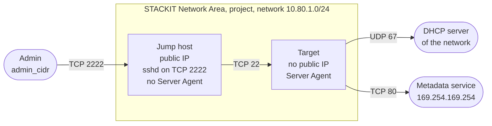

<!-- tags: iaas, compute, networking, sna, security-group, egress, cloud-init, server-agent, jump-host, ssh -->

# Restricted Egress for a VM with cloud-init and the STACKIT Server Agent

This example deploys a Linux VM, the target. Its security group allows outbound traffic only to an allow-list. The platform installs the STACKIT Server Agent on the target. A jump host is the only way to reach the target over SSH. The example adds the two egress rules that cloud-init, the Server Agent and Run Command need: DHCP and the metadata service. Every new security group also carries two default egress rules that allow all outbound traffic. The STACKIT provider cannot remove them, so Terraform deletes them through the IaaS API.

## What the example shows

Security group rules only allow traffic. While the two default egress rules exist, the allow-list restricts nothing. This example deletes them before the target boots for the first time. cloud-init runs at the first boot only, and the platform installs the Server Agent during the same boot.

[cloud-init](https://docs.cloud-init.io/en/latest/explanation/boot.html) is part of the image and reads metadata, user data and vendor data from the [metadata service](https://docs.stackit.cloud/products/compute-engine/server/basics/maintenance/) at `http://169.254.169.254`. The [STACKIT Server Agent](https://docs.stackit.cloud/products/compute-engine/server-agent/basics/introduction-to-server-agent/) is a service of its own. The platform [installs it through vendor data](https://docs.stackit.cloud/products/compute-engine/server-agent/getting-started/installing-server-agent-api/). [Run Command](https://docs.stackit.cloud/products/compute-engine/run-command/) sends a script to the target, and the Server Agent runs it.

The example creates:

- a STACKIT Network Area (SNA) with its regional configuration, a project attached to it and one network
- a **jump host** with a public IP, whose sshd listens on TCP 2222
- a **target** without a public IP, with the Server Agent and the egress allow-list
- a step that deletes the two default egress rules of the target's security group
- the role `run-command.editor` on the project for a service account, an existing one or one that Terraform creates

## Architecture



The jump host and the target each have their own security group. The jump host's group admits TCP 2222 from `admin_cidr`. The target's group admits TCP 22 from members of the jump host's group. Both groups are stateful, so answers to an allowed connection need no rule of their own. The jump host's group keeps its two default egress rules.

## Egress rules of the target

The default value of `egress_rules` holds the two rules that cloud-init, the Server Agent and Run Command need:

| Key        | Destination          | Protocol and port | What needs it                                                                                                                                                                                                                                      |
| ---------- | -------------------- | ----------------- | -------------------------------------------------------------------------------------------------------------------------------------------------------------------------------------------------------------------------------------------------- |
| `dhcp`     | `0.0.0.0/0`          | UDP 67            | The interface gets its IPv4 address through DHCP. The target sends its first request to the broadcast address and renews the lease at the DHCP server of the network ([RFC 2131](https://www.rfc-editor.org/rfc/rfc2131), sections 3.1 and 4.4.5). |
| `metadata` | `169.254.169.254/32` | TCP 80            | cloud-init reads its data, the vendor data included, from the metadata service. The platform installs the Server Agent through this vendor data. The Server Agent connects to this address only and receives its Run Command jobs through it.      |

Without the rule `dhcp` the interface gets no IPv4 address. cloud-init then reaches no metadata service, and the platform does not install the Server Agent. The rule allows UDP 67 to every IPv4 address, the internet included.

The default value has no rule for DNS, NTP or package mirrors. Until you add them, the target resolves no names, does not synchronise its clock and installs no updates. Your value of `egress_rules` replaces the default value, so copy `dhcp` and `metadata` into it. `ip_range` takes a CIDR or one of two names: `nameservers` for the nameservers of the network, `stackit` for every IPv4 range of the data source `stackit_public_ip_ranges`. Terraform creates one rule per address range.

```hcl
egress_rules = {
  # ... dhcp and metadata, copied from the default value in 020-variables.tf ...
  dns-udp = {
    description = "DNS: name resolution through the nameservers of the network"
    protocol    = "udp"
    port_min    = 53
    port_max    = 53
    ip_range    = "nameservers"
  }
  ntp = {
    description = "NTP: time synchronisation"
    protocol    = "udp"
    port_min    = 123
    port_max    = 123
    ip_range    = "0.0.0.0/0"
  }
}
```

Changed rules apply to the running target. cloud-init and the installation of the Server Agent run at the first boot only. To run both under the changed rules, replace the target with `terraform apply -replace=stackit_server.target`.

## How Terraform deletes the default egress rules

[Every new security group allows all egress traffic](https://docs.stackit.cloud/products/network/core-networking/security-groups/basics/concepts/). The IaaS API lists two default egress rules for this: one for IPv4 and one for IPv6. Neither has a protocol, a port range or an IP range. The provider cannot remove them, because `stackit_security_group` has no argument for its rules.

`070-default-egress-rules.tf` therefore runs [`remove-default-egress-rules.sh`](remove-default-egress-rules.sh), which deletes them with `curl` and `jq` through the IaaS API. The token comes from the ephemeral resource `stackit_access_token`, which Terraform writes neither to the plan nor to the state. The network interface and the server of the target wait for this step. The target therefore boots for the first time with the allow-list and without the default egress rules.

## Who may send Run Command

The Run Command API answers `403 Forbidden` to an identity without the permission `run-command.command.create` on the project. The service account that runs Terraform does not become a member of the new project. It acts through its role on `stackit_parent_container_id`. On a folder, the role `owner` contains no `run-command` permission.

`045-run-command-access.tf` therefore gives a service account the role `run-command.editor` on the project. Of the predefined roles that allow Run Command, it holds the fewest permissions. `run_command_service_account_email` names an existing account. Without it, Terraform creates one in the project. Terraform creates no key, because `stackit_service_account_key` keeps the private key in the state.

## Usage

### Prerequisites

- Terraform 1.10 or later and provider `stackitcloud/stackit` 0.118.0 or later.
- A STACKIT service account key that may create network areas in `stackit_org_id`, and projects, project members and service accounts under `stackit_parent_container_id`. `stackit_access_token` works with a service account key only.
- `bash`, `jq` and `curl` 7.55.0 or later on the machine that runs Terraform.
- An SSH key pair and an OpenSSH client with `-J` (ProxyJump).
- An authenticated [`stackit` CLI](https://github.com/stackitcloud/stackit-cli) for the image lookup and the checks.
- The ID of the public image `Ubuntu 24.04` (amd64). The jump host's user data expects its sshd layout: `/etc/ssh/sshd_config.d` without a port in the main configuration, and `ssh.socket` or `ssh.service`. STACKIT [deletes a released image after one year](https://docs.stackit.cloud/products/compute-engine/linux-server/faq/), so `image_id` has no default:

  ```bash
  stackit image list --all --project-id <existing-project-id>
  ```

### 1. Configure

```bash
cp terraform.tfvars.example terraform.tfvars
```

Replace every placeholder: `stackit_org_id`, `stackit_parent_container_id`, `stackit_admin_email` (owner of the project), `admin_cidr`, `ssh_public_key` and `image_id`.

`admin_cidr` must hold the address that STACKIT sees as the source of your SSH connection. Some internet lines use several public IPv4 addresses and pick one per destination. Compare `curl -4 https://api.ipify.org` with `curl -4 https://ifconfig.me`. If the two addresses differ and SSH times out, set `admin_cidr` to the other one. A changed rule admits connections about 85 seconds after `terraform apply` has finished.

`run_command_service_account_email` and `stackit_service_account_key_path` are optional.

### 2. Deploy

```bash
terraform init
terraform validate
terraform plan
terraform apply
```

### 3. Connect

```bash
$(terraform output -raw ssh_command)
```

The command has the form `ssh -J ubuntu@<jump host>:2222 ubuntu@<target>`. Terraform registers `ssh_public_key` as a STACKIT key pair and installs it on both machines. The key pair belongs to the service account that runs Terraform, not to the project. Its name must be unique for that account, so a second deployment with the same service account needs another `name_prefix`.

## Verify

`terraform output -raw verify_commands` prints these checks with the addresses and IDs of your deployment:

| Check                                              | Expected result                                                                                                                                                                                           |
| -------------------------------------------------- | --------------------------------------------------------------------------------------------------------------------------------------------------------------------------------------------------------- |
| `ss -Htln` on the jump host                        | Port 2222 is the only listener outside the loopback addresses.                                                                                                                                            |
| `cloud-init status --long` on the target           | `status: done`, and `detail` names `DataSourceOpenStackLocal`.                                                                                                                                            |
| `stackit server log` of the target, filtered       | `Datasource DataSourceOpenStackLocal`. `No active metadata service found` and `DataSourceNone` mean that cloud-init reached no metadata service, for example without the rule `dhcp`. SSH then fails too. |
| `systemctl is-active stackit-server-agent.service` | `active`                                                                                                                                                                                                  |
| `curl -m 10 https://1.1.1.1` on the target         | After 10 seconds `curl: (28)` and `000`. An HTTP status means that a rule allows the connection.                                                                                                          |
| `stackit security-group rule list` for both groups | The target's group holds TCP 22, `dhcp` and `metadata`, and no egress rule without protocol. The jump host's group holds TCP 2222 and its two default egress rules.                                       |

**Run Command** proves that the Server Agent works. `verify_commands` prints the call that enables the service. Run it once per project as the project owner, because `run-command.editor` cannot. Then create a key for the account from `terraform output -raw run_command_service_account_email` and activate it in a CLI profile of its own:

```bash
(umask 077; stackit service-account key create --email <run-command-sa-email> --project-id <project-id> \
  --output-format json --assume-yes > ~/.stackit/run-command-key.json)
stackit config profile create run-command --empty --no-set
STACKIT_CLI_PROFILE=run-command stackit auth activate-service-account \
  --service-account-key-path ~/.stackit/run-command-key.json
```

For an existing account, activate a key you already have. To create one, pass the project the account belongs to as `--project-id`. Then send the command that `verify_commands` prints, and read its result:

```bash
STACKIT_CLI_PROFILE=run-command stackit server command describe <command-id> \
  --project-id <project-id> --region <region> --server-id <target-server-id>
```

Status `completed` with exit code 0 shows a working Server Agent. `403 Forbidden` means that the identity lacks `run-command.command.create`. `404 Not Found` with `agent not found` means that no Server Agent has registered yet. On a new target, the Server Agent registers about two minutes after Terraform creates the server.

## Clean up

```bash
terraform destroy
rm ~/.stackit/run-command-key.json
stackit config profile delete run-command
```

`terraform destroy` removes the project, the network area and the service account Terraform created. An existing account loses its role and keeps its keys. Delete a key you created for it with `stackit service-account key delete <key-id> --email <run-command-sa-email> --project-id <its project>`.
