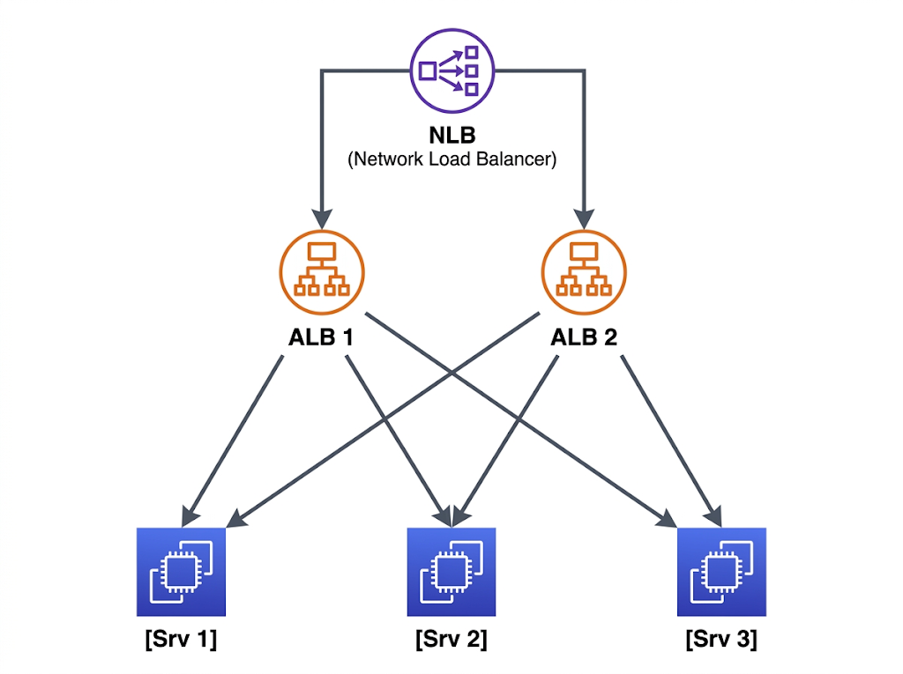

<!-- tags: load-balancer, alb, layer4, layer7, nginx, tls, cert, iaas, terraform, ha -->

# 🌐 STACKIT NLB → ALBs → nginx

Terraform code for a two-tier load balancing setup on STACKIT: a public **Network Load Balancer (Layer 4)** distributes the connections across **two private Application Load Balancers (Layer 7)**. Each ALB terminates TLS and balances across **three nginx servers** in different availability zones. The service is reachable via a **STACKIT DNS** name.

---

## 🏗️ Architecture



```
Internet
   │  https://web.nlbalb.runs.onstackit.cloud   (STACKIT DNS, A record)
   ▼
 NLB   stackit_loadbalancer (p50)        public IP, TCP 80/443, forwards unchanged
   │
   ├──────────────────────┐              ALB private IPs
   ▼                      ▼
 alb1 (p10)             alb2 (p10)       private only, TLS termination (443), HTTP (80)
   │ \     \           /     / │
   ▼  ▼     ▼         ▼     ▼  ▼         HTTP 80, every ALB serves every server
 srv1 (eu01-1)   srv2 (eu01-2)   srv3 (eu01-3)   Debian 12 + nginx (cloud-init)
   │
   └─ srv1 has an additional MGMT interface with a public IP for SSH
```

### Why an NLB in front of the ALBs?

A single ALB with plan `p10` handles up to **10,000 concurrent connections**. The NLB is placed in front to get beyond this limit: it accepts the connections and distributes them across several ALBs.

| Component             | Plan  | Concurrent connections           |
| --------------------- | ----- | -------------------------------- |
| NLB                   | `p50` | 50,000                           |
| ALB (each)            | `p10` | 10,000                           |
| **Total with 2 ALBs** |       | **20,000** (limited by the ALBs) |

The NLB plans are `p10` = 10,000, `p50` = 50,000, `p250` = 250,000 and `p750` = 750,000 concurrent connections ([STACKIT NLB service plans](https://docs.stackit.cloud/products/network/load-balancing-and-content-delivery/network-load-balancer/reference/service-plans/)).

The NLB forwards plain TCP, so every client connection is also one connection on an ALB. The capacity of the whole setup is therefore the **smaller** of NLB capacity and the sum of all ALBs. To scale, increase `alb_count` (e.g. `3` for 30,000 connections) and, above 50,000, the `nlb_plan`.

### Where is TLS terminated?

On the **ALBs**. The STACKIT NLB only supports `TCP`, `UDP`, `TCP_PROXY` and `TLS_PASSTHROUGH` and cannot decrypt traffic. The ALBs hold the certificate (all ALBs use the same one) and route by host/path, so they need to see plain HTTP anyway. Traffic between ALBs and servers is plain HTTP inside the private network.

---

## 📦 Components

| File                    | Content                                                                                                       |
| ----------------------- | ------------------------------------------------------------------------------------------------------------- |
| `010-provider.tf`       | Providers (`stackitcloud/stackit`, `hashicorp/tls`), project module                                           |
| `020-variables.tf`      | All variables                                                                                                 |
| `030-network.tf`        | `lan_network1` (10.220.1.0/24, LBs + servers), `wan_network` (10.220.0.0/24, management), NICs, SSH public IP |
| `040-security-group.tf` | Security groups `srv` and `ssh`                                                                               |
| `050-keypair.tf`        | SSH key pair from `var.public_key_file`                                                                       |
| `060-server.tf`         | Servers (`for_each` over `var.servers`)                                                                       |
| `070-alb.tf`            | ALBs (`alb_count`), certificate                                                                               |
| `080-nlb.tf`            | NLB with public IP, targets: all ALBs                                                                         |
| `090-dns.tf`            | DNS zone and A record                                                                                         |
| `100-outputs.tf`        | Outputs                                                                                                       |
| `cloud-init.yaml.tftpl` | nginx installation; policy routing for the MGMT interface                                                     |
| `project/`              | Module: network area (SNA), projects (`for_each` over `var.projects`), routing table                          |
| `scripts/issue-cert.sh` | Optional: Let's Encrypt certificate via certbot and STACKIT DNS                                               |

### Networking

- **Network area (SNA)** `10.220.0.0/16` with the label `preview/routingtables`. The provider experiment `routing-tables` is enabled.
- **Outbound internet** is provided by the internal STACKIT router (SNAT with a random public IP); no custom default route is needed.
- **Routing table** `nlbalb-rt` is created but not assigned to any network. To use it, add `stackit_routing_table_route` resources and set `routing_table_id = module.project.routing_table_id` on a network. If the table should take over the default route, it needs its own `0.0.0.0/0` route.

### Security

- Port security is **enabled** on all server interfaces.
- The ALBs have `disable_target_security_group_assignment = true`, so they do not attach their own security group to the targets. Access is granted by the security group `srv` instead:
  - ingress TCP 80 from the security groups of the ALBs only (one rule per ALB)
  - ingress TCP 22 between members of `srv` (jump from srv1 to the other servers)
  - egress TCP to anywhere and UDP 53 (package installation, DNS)
- Security group `ssh` on the MGMT interface: ingress TCP 22 from `var.ssh_allowed_cidr`.

### SSH access

`srv1` (`var.ssh_server`) gets a second interface `MGMT` in `wan_network` with a public IP. Since its default route points to the LAN interface, a small systemd service (`mgmt-route.service`) sets up policy routing so that replies from the management IP leave via the MGMT interface.

```bash
ssh debian@<ssh-public-ip>                          # srv1
ssh -J debian@<ssh-public-ip> debian@<srv2-lan-ip>  # srv2 via srv1
```

The exact commands are shown in the `ssh` output.

---

## 🚀 Getting Started

### Prerequisites

- Terraform ≥ 1.3
- STACKIT service account key with permissions to create network areas and projects in the organization
- An SSH public key

### Deployment

1. Initialize Terraform:

   ```bash
   terraform init
   ```

2. Adjust the defaults in `020-variables.tf`. **Required** (`terraform plan` fails until they are set):

   - `organization_id`: STACKIT organization ID
   - `owner_email`: owner e-mail of the projects
   - `service_account_key_path`: service account key JSON, e.g. `~/.stackit/credentials.json`
   - `public_key_file`: SSH public key, e.g. `~/.ssh/id_ed25519.pub`

   Recommended:

   - `ssh_allowed_cidr`: your own IP, e.g. `1.2.3.4/32`
   - `dns_zone_name`: must be globally unique below `runs.onstackit.cloud`
   - optional `projects`: project names and additional projects, e.g.
     ```hcl
     default = {
       project1 = { name = "my-nlbalb" }
       project2 = { name = "my-other-project", owner_email = "someone@example.com" }
     }
     ```

3. Plan and apply:

   ```bash
   terraform plan
   terraform apply
   ```

4. Test:
   ```bash
   curl -k https://web.<dns_zone_name>   # -k because of the self-signed certificate
   ```
   Repeated requests are answered by `srv1`, `srv2` and `srv3` (`Hello from srvX`).

### Optional: valid Let's Encrypt certificate

By default the ALBs use a self-signed certificate, so the setup works without any extra steps. To replace it with a valid certificate, run after the first `terraform apply`:

```bash
./scripts/issue-cert.sh
```

The script

1. installs `certbot` and the plugin `certbot-dns-stackit` into a local virtualenv (`.certbot/venv`, needs `python3-venv`),
2. requests a certificate for the `fqdn` output via DNS-01 challenge in the STACKIT DNS zone (takes about 5 minutes for DNS propagation),
3. writes `certbot.auto.tfvars` with `tls_cert_file` / `tls_key_file`, so every following `terraform apply` uses the certificate,
4. runs `terraform apply`. The new certificate is created before the old one is removed, so the ALBs keep serving.

Options via environment variables:

| Variable         | Default                           | Description                                                                          |
| ---------------- | --------------------------------- | ------------------------------------------------------------------------------------ |
| `SA_KEY`         | `/root/.stackit/credentials.json` | Service account key, needs DNS admin permissions in the project                      |
| `EMAIL`          | –                                 | E-mail for Let's Encrypt expiry notices                                              |
| `STAGING=1`      | –                                 | Use the Let's Encrypt staging CA for testing (untrusted certificate, no rate limits) |
| `PROPAGATION`    | `300`                             | Seconds to wait for DNS propagation                                                  |
| `AUTO_APPROVE=1` | –                                 | `terraform apply` without confirmation                                               |

**Renewal:** Let's Encrypt certificates are valid for 90 days. Run the script again; certbot only renews when the certificate expires within 30 days.

**Back to self-signed:** delete `certbot.auto.tfvars` and run `terraform apply`.

### Variables

| Variable                         | Default                                                 | Description                                                                                                  |
| -------------------------------- | ------------------------------------------------------- | ------------------------------------------------------------------------------------------------------------ |
| `organization_id`                | empty (**required**)                                    | STACKIT organization ID                                                                                      |
| `owner_email`                    | empty (**required**)                                    | Owner e-mail of the projects                                                                                 |
| `projects`                       | `{ project1 = { name = "nlb-alb-nginx" } }`             | Projects in the network area: key → `name`, optional `owner_email`. The workload is deployed into `project1` |
| `service_account_key_path`       | empty (**required**)                                    | Service account key JSON                                                                                     |
| `public_key_file`                | empty (**required**)                                    | SSH public key                                                                                               |
| `default_region`                 | `eu01`                                                  | Region                                                                                                       |
| `flavor`                         | `m1.2`                                                  | Machine type of the servers                                                                                  |
| `servers`                        | `{ srv1 = "eu01-1", srv2 = "eu01-2", srv3 = "eu01-3" }` | Servers: name → availability zone                                                                            |
| `alb_count`                      | `2`                                                     | Number of ALBs behind the NLB                                                                                |
| `alb_plan`                       | `p10`                                                   | Service plan of the ALBs                                                                                     |
| `nlb_plan`                       | `p50`                                                   | Service plan of the NLB                                                                                      |
| `ssh_server`                     | `srv1`                                                  | Server with the public MGMT interface                                                                        |
| `ssh_allowed_cidr`               | `0.0.0.0/0`                                             | Source range for SSH, **restrict this**                                                                      |
| `dns_zone_name`                  | `nlbalb.runs.onstackit.cloud`                           | DNS zone                                                                                                     |
| `dns_record_name`                | `web`                                                   | Record name, results in `<record>.<zone>`                                                                    |
| `tls_cert_file` / `tls_key_file` | empty                                                   | Optional real certificate (PEM, incl. chain); empty = self-signed                                            |

To add projects, add entries to `projects`.

---

## 🔐 Outputs

- `url`: HTTPS URL of the service
- `fqdn`: DNS name of the service
- `project_id`: STACKIT project ID
- `nlb_public_ip`: public IP of the NLB
- `ssh`: SSH commands for all servers

---

## ⚠️ Notes and Limitations

- **Self-signed certificate** by default; browsers will show a warning. Use `scripts/issue-cert.sh` for a valid certificate. It is not part of `terraform apply`, because the Terraform ACME provider (lego) has no STACKIT DNS provider.
- **Not changeable after creation** (changing them recreates the resource): on the ALBs `private_network_only`, `ephemeral_address`, `external_address`, `disable_target_security_group_assignment`; on the project the `networkArea` label.
- **Client IP**: the NLB forwards plain TCP, so nginx only sees the address of the ALB, not the client's.
- **NLB targets** are the ALBs' `private_address`. If STACKIT assigns a new private IP, the next `terraform apply` updates the NLB.
- **Destroy takes a few minutes longer**: projects are deleted asynchronously, so `terraform destroy` waits `project_deletion_wait` (default `180s`, in `project/020-variables.tf`) before deleting the network area region. If it still fails with "has still active projects", wait a moment and run `terraform destroy` again.
- **Experimental**: routing tables (`routing-tables`) are an experimental provider feature and may change.
- This setup is intended for **test and POC** environments; it is not auto-scaled.

---

## 📬 Support

For issues, please create a Ticket or contact professional-service@stackit.cloud

---

**Author**: Michael Sodan
**License**: Apache-2.0
