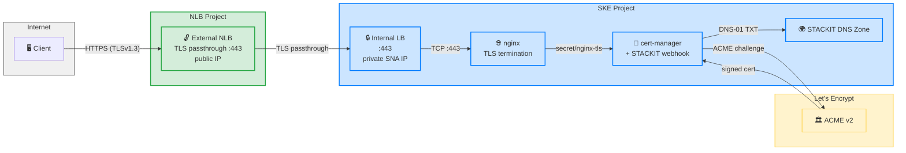
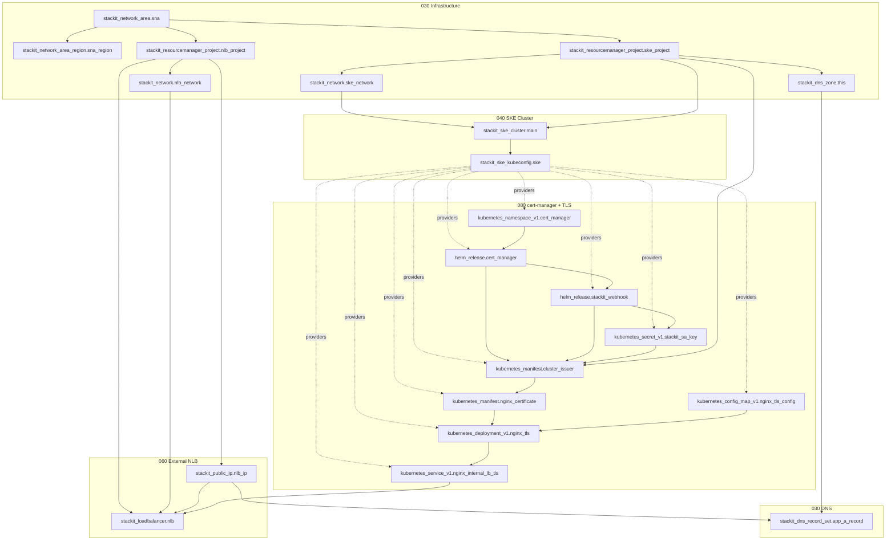

<!-- tags: ske, loadbalancer, tls, cert-manager, cross-network, sna, dns, passthrough, kubernetes -->

# Cross-Network SKE NLB with TLS Passthrough

Deploys an SKE cluster in one STACKIT project and an external Network Load Balancer (NLB)
in another project, both inside the same STACKIT Network Area (SNA). The NLB uses TLS
passthrough to forward encrypted traffic to a private internal LoadBalancer on the SKE
cluster, where nginx terminates TLS with a Let's Encrypt certificate managed by
cert-manager.

## Possible Use Cases

Cascading Network Load Balancers (NLBs) across distinct networks is particularly beneficial in scenarios requiring strict isolation and enterprise governance:

- **Centralized Ingress & Governance:** Direct inbound traffic through a dedicated hub project (e.g., managed by a central platform team) to enforce unified inspection via third-party WAFs or next-gen firewalls before reaching target workloads.
- **Network Segmentation & IP Scarcity:** Abstract hybrid on-premises connections via VPN or STACKIT Network Area (SNA) without exposing entire internal subnet ranges, mitigating CIDR exhaustion and avoiding complex routing tables.
- **Separation of Concerns (RBAC):** Allow platform engineers to control public VIPs, DNS, and baseline ingress policies, while application teams independently manage backend targets and internal NLBs within their own isolated projects.
- **Blast Radius Reduction (DMZ Pattern):** Keep backend networks strictly private without direct internet gateways or public floating IPs, ensuring workloads remain insulated if edge layers are compromised.
- **Lifecycle Decoupling:** Rebuild, scale, or perform Blue/Green migrations of internal backend clusters without altering public DNS records, edge certificates, or external VIP assignments.
- **CIDR Isolation:** Provide a clean network abstraction boundary that prevents end-to-end route leaking and resolves routing constraints across distinct environments.

## Architecture

```
Client ──HTTPS(443)──► External NLB (public IP, NLB project)
                          │ TLS passthrough
                          ▼
                  Internal LB (private SNA IP, SKE project)
                          │ port 443
                          ▼
                  nginx pod (TLS termination, SKE cluster)
```

### Key details

- **Two projects in one SNA** — the SKE cluster lives in the _SKE project_, the external
  NLB lives in the _NLB project_. Both share the same routed SNA network, so the NLB
  can reach the internal LB's private IP.
- **Private internal LB** — `lb.stackit.cloud/internal-lb: "true"` annotation ensures
  the K8s Service only gets a private SNA IP, no public address.
- **TLS passthrough** — the external NLB does not terminate TLS; it forwards the
  encrypted stream to the internal LB, which passes it to nginx.
- **cert-manager with STACKIT webhook** — DNS-01 challenges are handled via the
  `stackit-cert-manager-webhook`, which creates and deletes TXT records in the
  STACKIT DNS zone automatically.

### Target architecture



### Resource dependencies



## Prerequisites

- STACKIT service account with permissions to manage SNA, projects, networks, SKE,
  Load Balancer, and DNS
- Service account key JSON file

## Usage

```bash
# Copy and fill in your values
cp example.tfvars.example example.tfvars

# One apply deploys everything
terraform init
terraform apply -var-file=example.tfvars
```

Terraform creates the resources in dependency order:

1. SNA, projects, networks, DNS zone
2. SKE cluster
3. cert-manager + STACKIT webhook
4. ClusterIssuer + Certificate (DNS-01 challenge)
5. nginx deployment (TLS, port 443) + internal LB
6. External NLB (target IP resolved automatically from the internal LB)
7. DNS A record pointing to the external NLB public IP

## Outputs

| Output            | Description                                                    |
| ----------------- | -------------------------------------------------------------- |
| `app_domain`      | Full application URL, e.g. `app.xnet-ske.runs.onstackit.cloud` |
| `external_nlb_ip` | Public IP of the external NLB                                  |
| `internal_lb_ip`  | Private SNA IP of the internal LoadBalancer                    |
| `ske_project_id`  | Project ID for the SKE cluster                                 |
| `nlb_project_id`  | Project ID for the external NLB                                |

## Verify

```bash
# Check the certificate
openssl s_client -connect app.xnet-ske.runs.onstackit.cloud:443 -servername app.xnet-ske.runs.onstackit.cloud

# Or with curl
curl -kv https://app.xnet-ske.runs.onstackit.cloud
```
